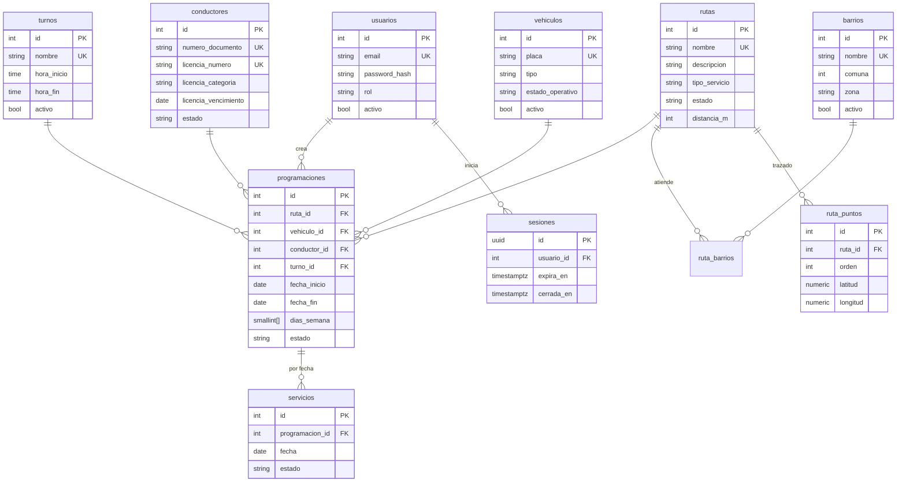
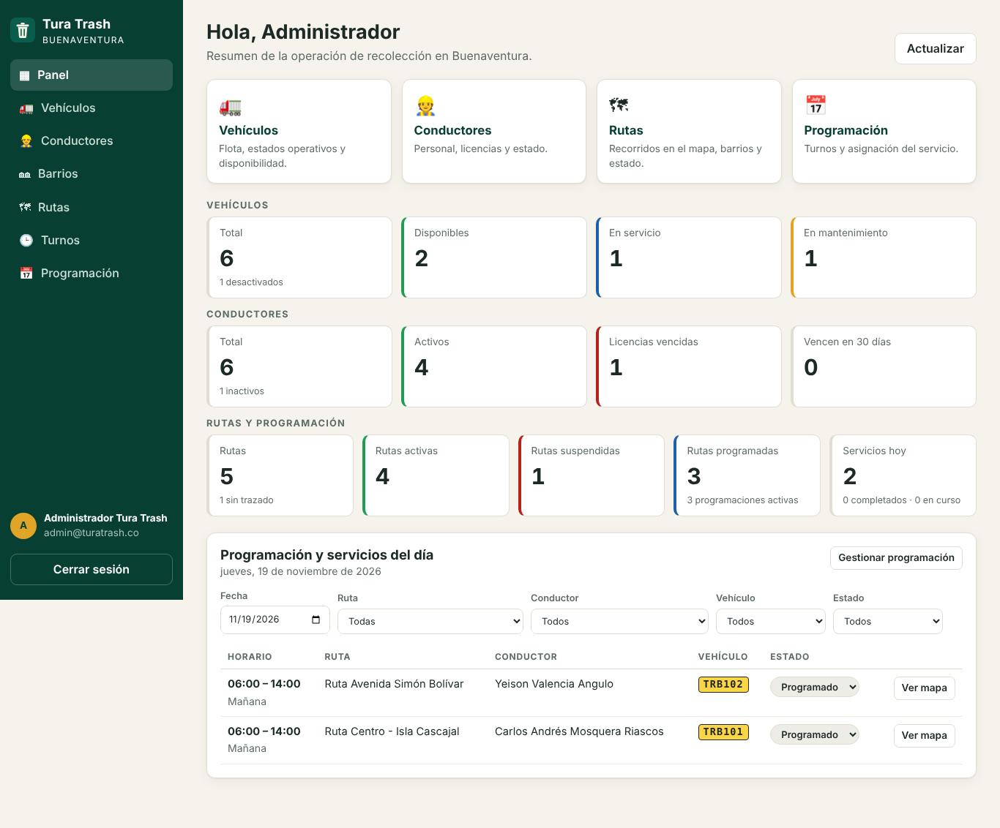
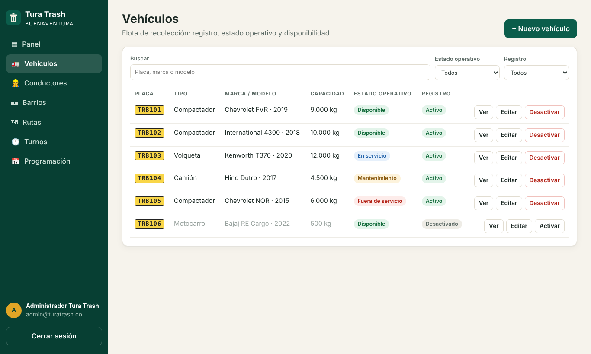

# Tura Trash

Sistema web para gestionar las rutas de recolección de residuos de **Buenaventura**: vehículos, conductores, barrios, rutas con trazado en el mapa, turnos, programación del servicio y un panel con indicadores en tiempo real.

Universidad del Pacífico · Ingeniería de Sistemas · Seminario de Actualización I · Proyecto Tura Limpia

> **Versión completa de referencia.** Este repositorio contiene el sistema completo (entregas 1 a 4) como guía técnica. Cada integrante del equipo sube su propia parte al repositorio oficial del equipo desde su cuenta.

---

## Contenido

1. [Funcionalidades](#funcionalidades)
2. [Tecnologías](#tecnologías)
3. [Arquitectura](#arquitectura)
4. [Base de datos](#base-de-datos)
5. [Cómo ejecutar el proyecto](#cómo-ejecutar-el-proyecto)
6. [Usuarios de prueba](#usuarios-de-prueba)
7. [Verificar el acceso administrativo](#verificar-el-acceso-administrativo)
8. [Endpoints](#endpoints)
9. [Reglas del negocio](#reglas-del-negocio)
10. [Pruebas](#pruebas)
11. [Evidencia de funcionamiento](#evidencia-de-funcionamiento)
12. [Variables de entorno](#variables-de-entorno)
13. [Despliegue](#despliegue)
14. [Limitaciones y trabajo pendiente](#limitaciones-y-trabajo-pendiente)

---

## Funcionalidades

| Entrega | Qué incluye |
|---|---|
| **1 · Acceso administrativo** | Inicio y cierre de sesión con JWT y sesiones en BD, mensajes de error comprensibles, validación de rol ADMIN, rutas protegidas, dashboard con acceso a Vehículos, Conductores, Rutas y Programación. |
| **2 · Vehículos y conductores** | CRUD completo con desactivación. Placa única y 4 estados operativos. Documento y licencia únicos, categoría y vencimiento de licencia, estado del conductor. Indicadores reales en el dashboard. |
| **3 · Rutas y mapa** | Barrios o sectores, rutas con nombre, descripción, tipo de servicio y estado (activar/suspender). Mapa centrado en Buenaventura para marcar el recorrido del inicio al final; se guarda en la BD y se reconstruye. |
| **4 · Programación** | Turnos con hora de inicio y fin. Programación de ruta + vehículo + conductor + turno por fecha y días. Editar, cancelar y desactivar. Validaciones y advertencia de conflictos. Dashboard final con servicios del día, filtros y mapa del recorrido. |

## Tecnologías

Backend propio e independiente con PostgreSQL. **No** se usan servicios tipo backend-as-a-service (Supabase, Firebase, Atlas): los endpoints, controladores y migraciones están en este repositorio.

| Capa | Tecnología |
|---|---|
| Base de datos | PostgreSQL 14+ (probado en 16) |
| Backend | Node.js 20+, Express 5, Knex (migraciones y seeds), JWT, bcrypt (bcryptjs), Zod, Helmet |
| Frontend | React 19, Vite, React Router, Leaflet + OpenStreetMap |
| Pruebas | `node:test` + Supertest contra PostgreSQL real |

## Arquitectura

```
tura-trash/
├── backend/
│   ├── db/migrations/        # 4 migraciones: crean la BD completa desde cero
│   ├── db/seeds/             # Usuarios de prueba y datos de demostración
│   ├── scripts/              # create-admin.js (administrador inicial)
│   ├── src/
│   │   ├── routes/           # Endpoints (controladores HTTP)
│   │   ├── services/         # Lógica y reglas del negocio
│   │   ├── validators/       # Validación de datos con Zod (mensajes en español)
│   │   ├── middleware/       # Autenticación, rol, errores, límite de intentos
│   │   ├── utils/            # Fechas (hora de Colombia), geografía, errores
│   │   ├── app.js            # Configuración de Express
│   │   └── server.js         # Arranque del servidor
│   ├── tests/                # Pruebas automáticas de los endpoints
│   └── knexfile.js
├── frontend/
│   └── src/
│       ├── api/              # Cliente HTTP (token, errores)
│       ├── auth/             # Contexto de sesión y rutas protegidas
│       ├── components/       # Layout, mapa, formularios, modales
│       └── pages/            # Login, Dashboard y un módulo por pantalla
├── docs/evidencia/           # Capturas del funcionamiento
├── docker-compose.yml        # PostgreSQL local (opcional)
└── render.yaml               # Despliegue en Render (BD + API + frontend)
```

**Flujo de una petición:** React → `fetch` con `Authorization: Bearer <token>` → Express → middleware `requiereAutenticacion` (firma + sesión abierta + usuario activo) → `requiereRol('ADMIN')` → validación Zod → servicio (reglas) → Knex → PostgreSQL. Todos los errores salen con el mismo formato:

```json
{ "error": { "codigo": "VALIDACION", "mensaje": "Revisa los datos enviados.", "campos": { "placa": "La placa debe tener el formato ABC123 (o ABC12D para motos)." } } }
```

## Base de datos

11 tablas creadas por migraciones. Las reglas básicas también están en la BD (claves únicas, `CHECK`, llaves foráneas), así que los datos quedan consistentes aunque alguien escriba directo en la base.



| Tabla | Para qué sirve |
|---|---|
| `usuarios` | Cuentas del sistema (rol `ADMIN` u `OPERADOR`, activo/inactivo). Contraseñas con hash bcrypt. |
| `sesiones` | Cada inicio de sesión. El JWT lleva el id de la sesión; al cerrar sesión el token deja de servir. |
| `vehiculos` | Placa única, tipo, capacidad, estado operativo (`DISPONIBLE`, `EN_SERVICIO`, `MANTENIMIENTO`, `FUERA_DE_SERVICIO`) y `activo` para desactivar. |
| `conductores` | Documento y licencia únicos, categoría (A1–C3), vencimiento y estado (`ACTIVO`, `VACACIONES`, `INCAPACITADO`, `INACTIVO`). |
| `barrios` | Barrios o sectores (comuna 1–12, zona urbana o rural). |
| `rutas` | Nombre, descripción, tipo de servicio, estado (`ACTIVA`/`SUSPENDIDA`) y distancia calculada. |
| `ruta_barrios` | Barrios que atiende cada ruta. |
| `ruta_puntos` | Trazado ordenado (1 = inicio). Menos de 2 puntos = ruta sin trazado. |
| `turnos` | Franjas horarias (la hora de fin debe ser posterior a la de inicio). |
| `programaciones` | Ruta + vehículo + conductor + turno, desde una fecha, en ciertos días (1 = lunes … 7 = domingo). Estados `ACTIVA`, `CANCELADA` (con motivo), `INACTIVA`. |
| `servicios` | Estado real de un servicio en una fecha (`PROGRAMADO`, `EN_CURSO`, `COMPLETADO`, `NO_REALIZADO`). |

Las fechas se calculan con la hora de Colombia (`America/Bogota`), aunque el servidor de la base de datos esté en UTC.

---

## Cómo ejecutar el proyecto

**Requisitos:** Node.js 20 o superior y PostgreSQL 14 o superior (instalado o con Docker).

### 1. Base de datos

Con Docker (crea `tura_trash` y `tura_trash_test`):

```bash
docker compose up -d
```

O con PostgreSQL instalado:

```sql
CREATE DATABASE tura_trash;
CREATE DATABASE tura_trash_test;  -- solo para las pruebas automáticas
```

### 2. Backend

```bash
cd backend
npm install
cp .env.example .env        # en Windows: copy .env.example .env
npm run db:migrate          # crea las tablas desde cero
npm run db:seed             # usuarios de prueba y datos de demostración
npm run dev                 # http://localhost:4000
```

Comprueba que responde: <http://localhost:4000/api/health> debe devolver `"estado": "ok"` y `"baseDatos": "conectada"`.

### 3. Frontend

En otra terminal:

```bash
cd frontend
npm install
cp .env.example .env
npm run dev                 # http://localhost:5173
```

### Crear el administrador inicial

`npm run db:seed` ya crea el administrador con los datos `ADMIN_*` del `.env`. Para crearlo o restablecer su contraseña por separado (por ejemplo, en producción, sin borrar datos):

```bash
cd backend
npm run create-admin
# o con datos propios:
npm run create-admin -- --email jefe@turatrash.co --password "ClaveSegura123*" --nombre "Jefe de operaciones"
```

Si el correo ya existe, actualiza la contraseña, lo deja como administrador activo y cierra sus sesiones abiertas.

### Reconstruir la base de datos desde cero

```bash
cd backend
npm run db:reset    # borra todas las tablas, vuelve a migrar y carga los datos de prueba
```

> ⚠️ `db:seed` y `db:reset` **borran todos los datos**. En producción usa solo `db:migrate` y `create-admin`.

## Usuarios de prueba

Los crea `npm run db:seed`:

| Correo | Contraseña | Rol | Para qué sirve |
|---|---|---|---|
| `admin@turatrash.co` | `Admin123*` | ADMIN | Entrar al panel |
| `operador@turatrash.co` | `Operador123*` | OPERADOR | Comprobar que alguien sin rol de administrador **no** entra |
| `inactivo@turatrash.co` | `Inactivo123*` | ADMIN (inactivo) | Comprobar el mensaje de cuenta desactivada |

Los datos de demostración incluyen 6 vehículos (uno en mantenimiento, uno fuera de servicio, uno desactivado), 6 conductores (uno de vacaciones, uno inactivo, uno con licencia vencida), 8 barrios, 5 rutas (una suspendida, una sin trazado), 3 turnos y programaciones que arrancan hace una semana para que el panel siempre muestre servicios del día.

> Estas credenciales son solo para desarrollo. Las del entorno público las envía el líder por Teams.

---

## Verificar el acceso administrativo

Con backend y frontend corriendo y los datos de prueba cargados:

| # | Paso | Resultado esperado |
|---|---|---|
| 1 | Abrir <http://localhost:5173/dashboard> sin haber iniciado sesión | Redirige a `/login` |
| 2 | Pulsar *Ingresar* con los campos vacíos | **"Ingresa tu correo y tu contraseña."** |
| 3 | `admin@turatrash.co` con una contraseña equivocada | **"Correo o contraseña incorrectos."** |
| 4 | `operador@turatrash.co` / `Operador123*` | **"Esta cuenta no tiene permisos de administrador."** |
| 5 | `inactivo@turatrash.co` / `Inactivo123*` | **"Tu cuenta está desactivada. Contacta al administrador."** |
| 6 | `admin@turatrash.co` / `Admin123*` | Abre el dashboard con **Vehículos, Conductores, Rutas y Programación** e indicadores |
| 7 | Recargar la página | La sesión se mantiene |
| 8 | Pulsar *Cerrar sesión* | Vuelve al login con **"Cerraste sesión correctamente."** |
| 9 | Intentar abrir `/dashboard` otra vez | Redirige a `/login` |

### Verificación directa en el backend

```bash
# Sin token -> 401 "Debes iniciar sesión para continuar."
curl -i http://localhost:4000/api/dashboard

# Login -> { token, expiraEn, usuario }
curl -s -X POST http://localhost:4000/api/auth/login \
  -H "Content-Type: application/json" \
  -d '{"email":"admin@turatrash.co","password":"Admin123*"}'

# Con el token -> 200 con usuario, módulos e indicadores
curl -s http://localhost:4000/api/dashboard -H "Authorization: Bearer TOKEN_AQUI"

# Cerrar sesión -> después, el mismo token responde 401 SESION_CERRADA
curl -s -X POST http://localhost:4000/api/auth/logout -H "Authorization: Bearer TOKEN_AQUI"
```

### Cómo funciona la sesión

1. `POST /api/auth/login` compara la contraseña con **bcrypt**. Si es correcta y el usuario es ADMIN activo, crea una fila en `sesiones` y devuelve un **JWT** firmado que lleva el id de esa sesión.
2. El frontend guarda el token y lo envía en cada petición: `Authorization: Bearer <token>`.
3. `requiereAutenticacion` valida firma y vencimiento, y confirma en la BD que la sesión sigue abierta y el usuario sigue activo.
4. `requiereRol('ADMIN')` bloquea con **403** a quien no sea administrador.
5. `POST /api/auth/logout` marca la sesión como cerrada: el token deja de servir aunque no haya vencido.
6. Tras 10 intentos fallidos del mismo correo desde la misma IP, el login se bloquea 15 minutos.

El frontend también protege las páginas (`RutaProtegida`), pero quien decide de verdad es siempre el backend.

---

## Endpoints

Todos, salvo `health` y `login`, exigen `Authorization: Bearer <token>` de un **ADMIN**. Los listados responden `{ datos: [...], total }`.

| Método | Ruta | Descripción |
|---|---|---|
| GET | `/api/health` | Estado del backend y de la conexión con PostgreSQL (público) |
| POST | `/api/auth/login` | Inicia sesión. Body: `{ email, password }` (público) |
| POST | `/api/auth/logout` | Cierra la sesión actual |
| GET | `/api/auth/me` | Usuario de la sesión |
| GET | `/api/dashboard` | Usuario, módulos e indicadores calculados en el momento |
| GET | `/api/vehiculos` | Listar. Filtros: `q`, `estado_operativo`, `activo` |
| GET · POST · PUT | `/api/vehiculos/:id` · `/api/vehiculos` · `/api/vehiculos/:id` | Consultar, registrar, editar |
| PATCH | `/api/vehiculos/:id/estado` · `/desactivar` · `/activar` | Cambiar estado operativo, desactivar, reactivar |
| GET | `/api/conductores` | Listar. Filtros: `q`, `estado` |
| GET · POST · PUT | `/api/conductores/:id` · `/api/conductores` · `/api/conductores/:id` | Consultar, registrar, editar |
| PATCH | `/api/conductores/:id/estado` · `/desactivar` · `/activar` | Cambiar estado, desactivar (INACTIVO), reactivar |
| GET · POST · PUT | `/api/barrios` · `/api/barrios` · `/api/barrios/:id` | Listar (`q`, `activo`), registrar, editar |
| PATCH | `/api/barrios/:id/desactivar` · `/activar` | Desactivar o reactivar |
| GET | `/api/rutas` · `/api/rutas/:id` | Listar (`q`, `estado`, `tipo_servicio`) y consultar con barrios y trazado |
| POST · PUT | `/api/rutas` · `/api/rutas/:id` | Crear o editar (opcional: `barrio_ids`, `puntos`) |
| PUT | `/api/rutas/:id/trazado` | Reemplaza el recorrido: `{ puntos: [{ latitud, longitud }, ...] }` |
| PATCH | `/api/rutas/:id/suspender` · `/activar` | Suspender (`{ motivo }`) o activar |
| GET · POST · PUT | `/api/turnos` · `/api/turnos` · `/api/turnos/:id` | Listar, crear, editar |
| PATCH | `/api/turnos/:id/desactivar` · `/activar` | Desactivar (si no está en uso) o activar |
| GET | `/api/programaciones` | Listar. Filtros: `estado`, `ruta_id`, `vehiculo_id`, `conductor_id`, `turno_id`, `fecha` |
| POST | `/api/programaciones/validar` | Revisa reglas y conflictos **sin guardar** (`?excluir_id=` al editar) |
| GET · POST · PUT | `/api/programaciones/:id` · `/api/programaciones` · `/api/programaciones/:id` | Consultar, crear, editar |
| PATCH | `/api/programaciones/:id/cancelar` · `/desactivar` · `/activar` | Cancelar (`{ motivo }`), desactivar o reactivar |
| GET | `/api/servicios` | Servicios de un día. Filtros: `fecha` (por defecto hoy), `ruta_id`, `vehiculo_id`, `conductor_id`, `estado` |
| PUT | `/api/servicios/:programacionId/:fecha` | Cambiar el estado de un servicio: `{ estado, observaciones }` |

Códigos de respuesta: `400` validación, `401` sin sesión o sesión inválida, `403` sin permisos, `404` no existe, `409` duplicado o conflicto de horario, `422` regla del negocio, `429` demasiados intentos.

## Reglas del negocio

- **Placa** en mayúsculas sin espacios ni guiones (`abc-123` → `ABC123`), formato `ABC123` o `ABC12D`, única.
- **Conductor:** documento y licencia únicos (se marcan los dos campos si ambos están repetidos); la cédula (CC) debe tener 6 a 10 dígitos.
- **Trazado:** mínimo 2 puntos, máximo 500, dentro del municipio de Buenaventura (evita latitud y longitud invertidas).
- **Programación:**
  - No se asignan vehículos **inactivos, en mantenimiento o fuera de servicio**.
  - No se asignan conductores **inactivos, de vacaciones, incapacitados o con la licencia vencida** al inicio.
  - No se programan rutas **suspendidas o sin trazado**, ni con turnos inactivos.
  - No se crean programaciones con fecha de inicio en el pasado, ni con días que no caen entre las fechas elegidas.
  - **Conflictos:** si el vehículo o el conductor ya tienen otra programación activa con un día real en común y horario que se cruza, se rechaza con `409` y el detalle de cada choque. El formulario lo advierte antes de guardar.
  - Advierte (sin bloquear) si la licencia vence durante la programación.
- Al desactivar o poner en mantenimiento un vehículo, inactivar un conductor o suspender una ruta con programaciones activas, el sistema lo guarda y **advierte** cuántas programaciones quedan afectadas. En el dashboard esos servicios aparecen con alerta.
- No se cambia el horario de un turno con programaciones activas ni se desactiva un turno en uso.

## Pruebas

```bash
cd backend
npm test
```

**Pruebas en el navegador (opcional):** `backend/tests/e2e/` tiene dos scripts de Playwright que recorren la aplicación como un usuario (login, cada módulo, mapa, programación y conflictos) y guardan capturas. Con backend y frontend corriendo y `npm run db:seed` recién ejecutado:

```bash
pip install playwright && playwright install chromium
python backend/tests/e2e/e2e_entrega1.py
python backend/tests/e2e/e2e_completo.py
```

Las pruebas reconstruyen `TEST_DATABASE_URL` desde cero (migraciones + seeds) y cubren 54 casos: login correcto e incorrecto, validaciones, cuenta desactivada, rol, token alterado, cierre de sesión, CRUD de vehículos y conductores con duplicados, indicadores que cambian con los datos, barrios, rutas, trazado guardado y reconstruido en orden, turnos, todas las validaciones de programación, conflictos de vehículo y conductor, servicios del día con filtros y el dashboard final.

## Evidencia de funcionamiento

Capturas en [`docs/evidencia`](docs/evidencia), tomadas con las pruebas en navegador.

| | |
|---|---|
| **1. Login**  | **2. Credenciales incorrectas**  |
| **3. Usuario sin permisos de administrador**  | **4. Dashboard del administrador**  |
| **5. Módulo de vehículos**  | **6. Sesión cerrada**  |

## Variables de entorno

**backend/.env**

| Variable | Descripción |
|---|---|
| `DATABASE_URL` | Conexión a PostgreSQL |
| `DATABASE_SSL` | `true` si la base de datos está en la nube |
| `TEST_DATABASE_URL` | Base de datos solo para `npm test` (se borra en cada ejecución) |
| `PORT` | Puerto del backend (4000 por defecto) |
| `JWT_SECRET` | Clave para firmar tokens. **En producción, 32+ caracteres aleatorios** (obligatoria) |
| `JWT_EXPIRES_IN` | Duración de la sesión (ej. `8h`) |
| `CORS_ORIGIN` | URL(s) del frontend permitidas, separadas por coma |
| `ADMIN_NOMBRE`, `ADMIN_EMAIL`, `ADMIN_PASSWORD` | Administrador inicial |

**frontend/.env**

| Variable | Descripción |
|---|---|
| `VITE_API_URL` | URL del backend, sin `/` al final |

Los archivos `.env` **no se suben a GitHub** (están en `.gitignore`). En la nube se configuran en el panel del proveedor.

## Despliegue

Obligatorio desde la entrega 3. Opción gratuita con **Render** usando el archivo `render.yaml`:

1. En Render: **New → Blueprint** y elige este repositorio. Crea la base de datos PostgreSQL, el backend y el frontend.
2. Completa las variables marcadas como pendientes: `CORS_ORIGIN` (URL del frontend), `ADMIN_EMAIL`, `ADMIN_PASSWORD` y `VITE_API_URL` (URL del backend). `JWT_SECRET` se genera solo.
3. Cuando el backend esté arriba, abre su **Shell** en Render y ejecuta una sola vez `npm run create-admin`.
4. Comprueba `https://<backend>/api/health` y entra al frontend con el administrador.

Alternativa: frontend en **Vercel** (raíz `frontend`, el archivo `vercel.json` ya hace que las rutas de React funcionen al recargar) y backend + PostgreSQL en Render o Railway.

## Limitaciones y trabajo pendiente

- **Trazado en línea recta:** el recorrido une los puntos marcados con líneas rectas; no se ajusta automáticamente a las calles. Para más precisión hay que marcar más puntos. *Próximo semestre:* ajuste a la red vial con un servicio de rutas (OSRM o similar).
- **Turnos dentro del mismo día:** un turno no puede pasar de medianoche (por ejemplo 22:00 a 06:00). Se pueden crear dos turnos (22:00–23:59 y 00:00–06:00).
- **Un solo rol en el panel:** solo el ADMIN usa el sistema. *Pendiente:* panel para operadores y conductores (ver servicios asignados, marcar avance desde el celular).
- **Sin gestión de usuarios en pantalla:** los administradores se crean con `npm run create-admin`.
- **Límite de intentos en memoria:** el bloqueo por intentos fallidos funciona con un solo servidor; con varias instancias habría que guardarlo en la BD o en Redis.
- **Datos de demostración ficticios:** las coordenadas de las rutas de ejemplo son aproximadas.
- **Plan gratuito de Render:** el backend se duerme tras 15 minutos sin uso (la primera petición tarda unos segundos) y la base de datos gratuita vence a los 30 días; para la entrega final conviene un plan pago o renovar la base.
